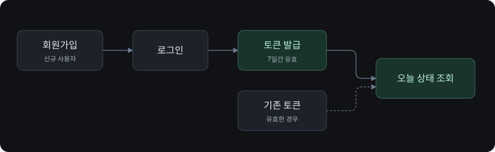
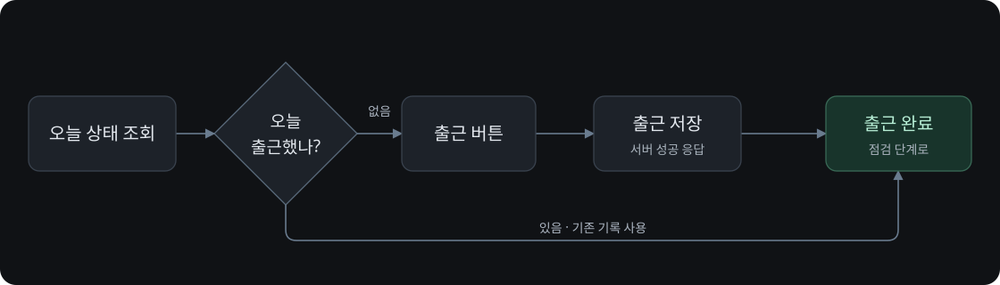
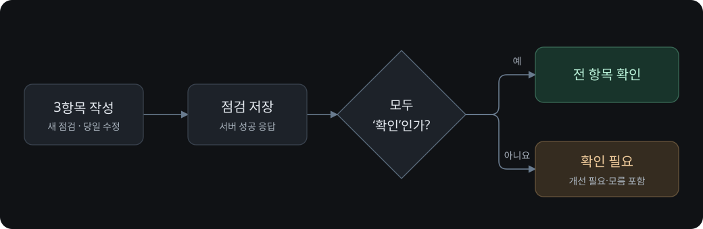
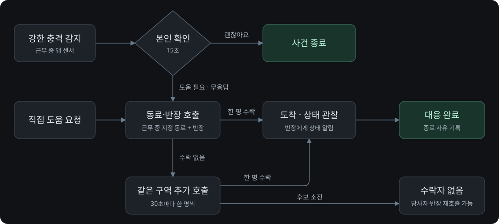
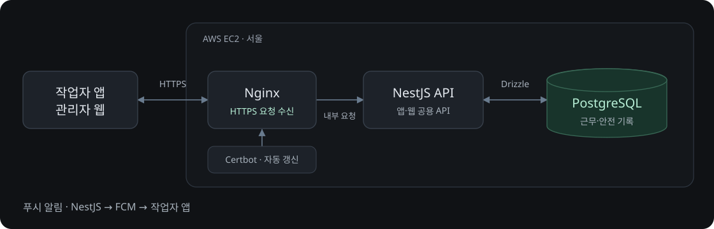

# SAFELOOP 백엔드 흐름

[API 명세](API.md)

## 로그인과 현장 참여

- 반장: 현장 생성 → 코드 공유
- 작업자: 코드로 현장 이름·반장 확인 → 참여
- 작업 정보: 직종·구역 필수, 예상 일당 선택

## 출근

- 한국 날짜 기준 하루 한 현장에 출근
- GPS 사용 불가: 출근 저장, 위치 ‘미확인’ 표시

## 작업 전 안전점검

| 항목·상황 | 처리 |
| --- | --- |
| 본인 점검 | 추락 위험 구역 / 바닥·개구부·안전난간 / 안전모·턱끈·안전대 |
| 새로 ‘모름’ 선택 | 반장에게 확인 요청 |
| 동료 점검 | 짝과 서로 보호구 확인. 사진 첨부 또는 확인 결과만 저장 |
| 불일치 | 조치 후 다시 확인 |
| 짝 없음 | 반장이 확인 |
| 퇴근 | 근로 기록에 퇴근 시각 저장 |
| 점검·동료 확인 건너뜀 | 출퇴근 기록 유지 |

## 이상 감지와 긴급 대응

- **수락자 없음**: 이미 초대받은 사람은 계속 수락 가능
- **119 버튼**: 오프라인에서도 폰의 전화 화면 먼저 열기. 서버에는 전화 화면을 연 사실만 기록
- **일반 안전 확인**: 휴식 복귀·교대·고위험 작업 전후에 전송. 15분간 무응답 시 ‘미확인’ 표시

## 위험 신고와 조치

작업자 신고 → 현장 구성원 조치·사진 등록 → 다른 구성원 재확인 → 완료

- 반장: 조치 담당자 지정 가능
- 신고자·실제 조치자: 재확인 불가
- 익명 신고: 반장에게도 신고자 이름 비공개

## 서버 구조와 관리자 웹

- **현장 대시보드**: 출근 인원·점검 요청·미조치 위험 확인
- **호출 상세**: FCM 발송·단말 수신·사용자 열람·수락자 도착 구분
- **기록 조회**: 작업자는 본인 기록, 반장은 현장 기록
- **정정**: 원본에 별도 기록으로 추가
- **보고서**: 근로·월간·사고 보고서를 CSV·PDF로 내보내기
