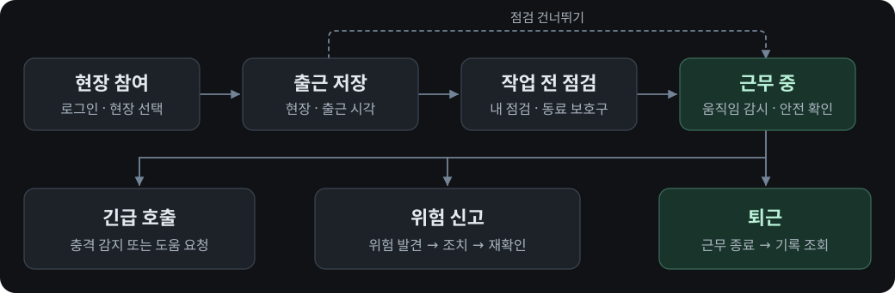
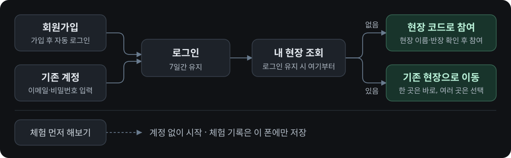
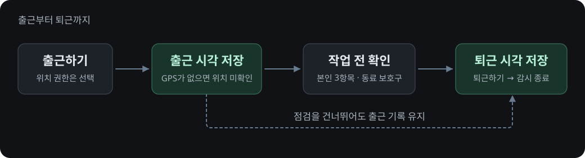
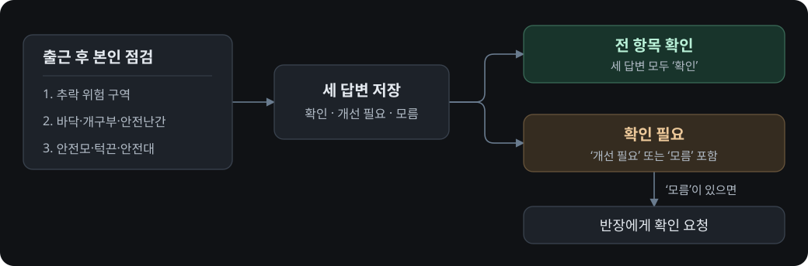
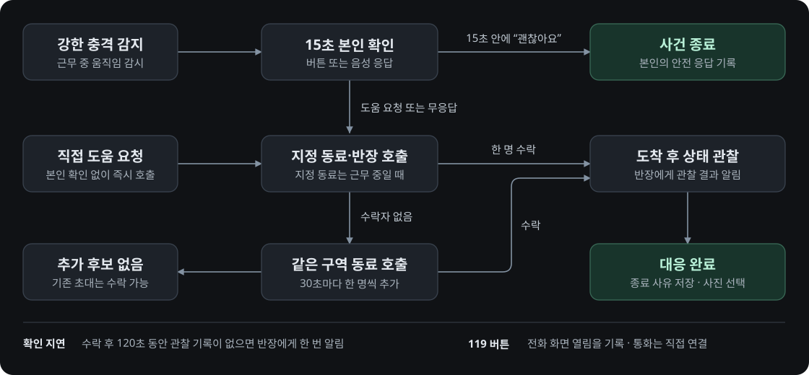
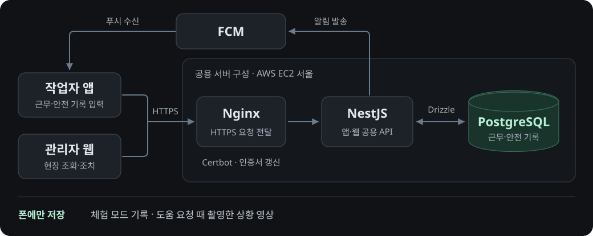
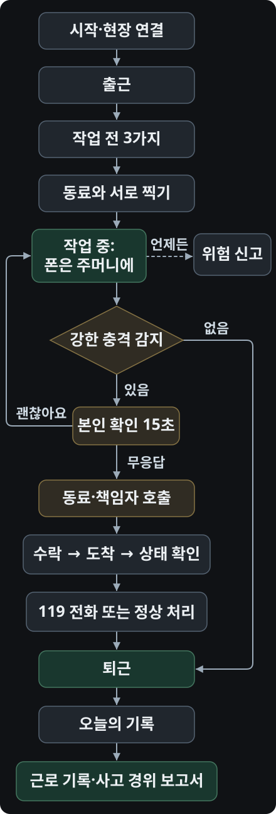

# SAFELOOP 흐름도

## 현재 구현 · 작업자 앱 #20과 서버

### 1. 하루 전체

### 2. 로그인과 현장 참여

### 3. 출근과 퇴근

### 4. 작업 전 안전점검

### 5. 긴급 호출과 119

### 6. 앱·서버·관리자 웹

## 와이어프레임의 화면 이동

[화면 이동만 크게 보기](diagrams/screen-navigation.svg)

기획 그림에서 119는 동료 도착 뒤에 등장하지만, 실제 앱에서는 본인 확인 중에도 선택 가능. 대응을 마친 뒤 퇴근은 작업자가 별도로 선택.

[작업자 화면 목록](https://github.com/jmwshye/safeloop-app-/blob/1b749c6fa88348850a9f9ed2b9ad1762ce7d796a/docs/wireframe.md#4-작업자-앱-화면) · [관리자 웹 화면 목록](https://github.com/jmwshye/safeloop-app-/blob/1b749c6fa88348850a9f9ed2b9ad1762ce7d796a/docs/wireframe.md#5-관리자-웹) · [기획서의 하루·안전 확인 표](https://github.com/jmwshye/safeloop-app-/blob/1b749c6fa88348850a9f9ed2b9ad1762ce7d796a/docs/기획서.md#2-서비스-흐름)

## 흐름별 동작

**실제 계정**의 근무 기록은 서버에 저장. **체험 모드**는 가입 없이 사용하며 기록과 모의 호출은 해당 폰에만 보관.

### 로그인 · 현장 참여

- 반장이 현장을 만들고 참여 코드 공유
- 처음 참여하는 작업자는 현장 이름과 반장을 확인한 뒤 참여. 직종·작업 구역 필수, 예상 일당 선택

### 출근 · 작업 전 점검

- **동료 보호구** · 짝이 서로 확인하고 사진 첨부 또는 확인 결과만 저장. 촬영한 사진은 폰에서 감지한 얼굴을 가리고 턱끈은 보존. 불일치면 조치 후 재확인. 짝이 없으면 반장이 확인
- **점검 건너뛰기** · 먼저 저장한 출근 기록 유지

### 근무 중 안전 확인

| 계기 | 작업자 응답 | 무응답 |
| --- | --- | --- |
| 휴식 복귀·교대, 고위험 작업 시작·종료 | 괜찮음 → 응답 기록 / 도움 필요 → 긴급 호출 | 서버는 15분 뒤 ‘미확인’. 동료 자동 호출 없음 |
| 움직임 감시 중 강한 충격과 뒤이은 정지 감지 | 15초 본인 확인에서 버튼 또는 음성으로 응답 | 동료·반장에게 긴급 호출 |

체험 모드의 휴식 복귀 알림은 13:00·15:30, 응답 시간은 5분.

### 긴급 호출 · 119

- **호출을 시작한 뒤** · 본인이 뒤늦게 `괜찮아요`라고 답하면 실제 서버는 응답을 기록하고 현장 확인을 계속. 같은 상황에서 아직 수락자가 없으면 #20 체험 모드는 사건 종료
- **수락자가 없을 때** · 당사자·반장이 재호출 요청 가능
- **상황 영상** · 본인 확인 화면에서 직접 도움을 요청하면, 설정·카메라 권한이 있을 때 후면 카메라로 최대 30초 무음 녹화. 영상은 해당 폰에서 보기·삭제
- **119 버튼** · 오프라인에서도 전화 화면 열기 → 작업자가 통화 버튼 선택. 앱의 ‘전화 화면 열림’ 기록만으로 신고 접수 여부를 알 수 없음

### 위험 신고 · 조치

**위험 발견 → 신고 → 조치 사진 등록 → 같은 현장의 다른 사람이 재확인 → 완료**

- 말로 신고하면 위험 종류·위치·설명을 채운 뒤 작업자가 확인하고 전송. 익명 신고는 반장에게도 신고자 이름 비공개
- 반장이 조치 담당자를 지정할 수 있고, 신고자와 실제 조치자는 재확인에서 제외

### 퇴근 · 기록

- **작업자** · 퇴근 저장 → 움직임 감시 종료 → 근무 시간·예상 일당 확인. 내 근로 기록은 기간을 골라 CSV·PDF로 내보내기
- **기록 정정** · 작업자가 본인 기록의 정정 사유 제출 → 반장이 승인·반려 → 결과를 원본에 연결해 별도 보관
- **사고 경위** · 센서 감지와 작업자 응답·수락자 도착을 시간순으로 구분. 반장은 현장 기록과 월간 집계 조회

### 앱 · 서버 · 관리자 웹

반장 대시보드에서 출근 인원·안전점검 확인 요청·미조치 위험 조회. 긴급 호출은 푸시 발송, 단말 수신, 사용자 열람, 수락자 도착을 구분.

## #21·#22를 반영할 때 달라지는 흐름

- [#21 사진](https://github.com/jmwshye/safeloop-app-/pull/21) · 촬영 직후 원본 확인 → 얼굴이 감지되면 가린 사진을 기록에 사용. 연결 모드에서는 가리기 전 사진을 따로 올리고, 올린 사람만 원본 열람 가능
- **#21 긴급 음성 응답** · 15초 본인 확인에서 “괜차나”, “도와조” 같은 표현도 인식. 도움 요청을 우선 처리하고, 119 통화는 작업자가 전화 화면에서 선택
- [#22 안전 온도 · 시험 기능](https://github.com/jmwshye/safeloop-app-/pull/22) · 내 정보 → 나의 안전 온도 → 닫으면 내 정보. 퇴근 후 ‘오늘’ 화면에는 당일 증가분만 표시. 앱이 불러온 근무·활동 기록으로 계산해 본인만 확인

## #20과 별도로 로컬에서 확인한 흐름

| 상황 | 앱에서 보이는 결과 |
| --- | --- |
| 가입·로그인 중 서버 연결 실패 | 입력한 내용을 유지한 채 연결 오류 안내. 개발용 앱에서 서버 주소를 바꾸고 재시도 가능 |
| B현장 근무 중 A현장 호출 도착 | 현장 이름과 함께 ‘내 안전 확인·응답 필요·대응 중’ 구분. A를 열어도 B 출근·감시 유지. 거절하거나 다른 사람이 수락하면 ‘응답 필요’에서 제외 |
| 근무 중 화면을 끄거나 움직임이 없는 경우 | 감시 유지. 센서값이 끊기면 ‘재연결 중’, 휴대 여부를 알 수 없으면 ‘미확인’. 퇴근하거나 직접 끄면 감시 종료 |
| 점검·근무 정보·정정 작성 중 화면 회전 또는 저장 실패 | 입력 유지 → 저장 성공 시 창 닫기. 정정 재시도는 한 건만 저장. 점검에 ‘모름·개선 필요’가 섞이면 ‘응답 완료’와 답변별 개수 표시 |
| 가입 성공 후 자동 로그인 실패 | 로그인 화면으로 이동. 세션 만료·계정 전환 때 이전 계정의 현장·감시 정리 |
| 긴급 호출 없이 정시 안전 확인만 도착 | 알림 아이콘에 표시 → 확인 요청을 열어 응답 |

[#20 API 요청·응답 예시와 오류 코드](https://github.com/jmwshye/safeloop-app-/blob/1b749c6fa88348850a9f9ed2b9ad1762ce7d796a/backend/API.md)
