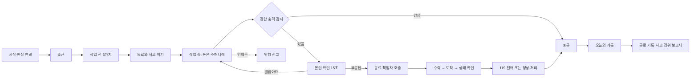

# 안전고리 와이어프레임

2026-11-02 · 앱 화면 기준 v1

앱 화면은 이 문서와 캔버스를 따릅니다.

- **캔버스(와이어프레임): [안전고리 와이어프레임](https://claude.ai/artifact/XuvoVp4sTKYiqqbA9EHAaT)** (링크로 공유)
- 제품 기준: [프로젝트 헌장](https://claude.ai/artifact/QadKtQskLYTUSGinpBuT5c), [기획서](기획서.md)
- 이전 시안: [안전고리 화면 시안](https://claude.ai/artifact/Lz6o6yGJyZoNdL1Q1LpxB8) (화면 흐름은 재사용, 색과 틀은 새로 설계)

헌장의 디자인 원칙(색 체계, 버튼 크기, 경고 테이프 등)은 초기 초안이라 따르지 않아도 됩니다. 이 문서는 헌장의 **기능과 안전 규칙**을 기준으로 삼고, 화면 디자인은 더 좋은 쪽으로 바꿀 수 있습니다.

화면의 이름, 현장, 금액, 시각은 모두 예시입니다.

## 1. 설계 방향

작업자는 작업 전후의 짧은 시간에만 폰을 봅니다. 그래서 앱을 여는 순간 **지금 할 일 하나**가 보여야 합니다.

| 기준 | 적용 |
| --- | --- |
| 한 화면 한 행동 | 화면 아래쪽 큰 버튼 하나. 나머지는 보조 |
| 하루 흐름 중심 | 메뉴를 찾지 않아도 `오늘` 탭이 시간대에 맞게 바뀜 |
| 작업 중 무조작 | 작업 중에는 화면을 볼 필요가 없음. 입력은 작업 전후와 휴식 때만 |
| 나를 위한 기록 | 첫 화면에서 근로 기록과 일당이 보임. 점검은 출근의 조건이 아님 |
| 사람과 시스템 구분 | `사람이 확인`과 `시스템이 추정`을 색이 아닌 표시로도 구분 |
| 평소에는 차분하게 | 빨강은 긴급에만 사용. 평소 화면은 흰 바탕과 파랑 |

### 화면 구성 방식

| 방식 | 적용 |
| --- | --- |
| 사용자 여정별로 줄을 나눔 | 시작 → 아침 → 작업 중 → 긴급 → 신고 → 기록 → 관리자 |
| 사용자별로 화면 성격을 다르게 함 | 작업자는 큰 글씨 생활 앱, 관리자는 밝은 업무 화면 |
| 화면 번호를 코드까지 연결 | `3-1` 같은 번호를 Compose 화면 주석과 PR에 그대로 사용 |
| 화면끼리 눌러서 이동 | 주요 버튼을 다음 화면과 연결 |
| 상태 전환을 표로 정의 | 출근 전·근무 중·미휴대 같은 상태를 7장에 정리 |
| 색, 글자, 부품을 먼저 정함 | 색, 글자, 버튼, 카드, 상태 칩을 먼저 고정 |
| 눌리는 느낌의 버튼 | 주 버튼에 아래 4px 그림자. 장갑 착용을 고려해 눌림을 분명하게 표현 |
| 실제 기록으로만 문장 구성 | 오늘의 기록은 실제 이벤트만 표시. 없는 내용을 만들지 않음 |
| 말투를 사용자에게 맞춤 | 짧고 쉬운 존댓말. 어려운 용어와 영어 제목을 쓰지 않음 |
| 빈 상태와 실패 상태도 설계 | 기록 없음, 연결 실패, 수락자 없음을 화면으로 설계 |

### 넣지 않는 것

| 요소 | 이유 |
| --- | --- |
| 점수, 순위, 게임 같은 보상 | 헌장이 점수와 순위를 경계함. 안전을 점수로 표시하지 않음 |
| 캐릭터와 말풍선 | 작업자에게 필요한 것은 상태와 행동 |
| 글자를 거의 없애는 화면 | 작업자는 글을 읽을 수 있음. 대신 문장을 짧게 씀 |
| 태블릿 화면 | 작업자 Android 폰과 관리자 PC 웹만 필요 |
| 경고를 약하게 표현 | 15초 긴급 화면은 강해야 함. 위험 표현은 긴급 화면에만 사용 |

## 2. 디자인 기준

### 색

대비는 계산으로 확인한 값입니다.

| 이름 | 값 | 쓰임 | 대비 |
| --- | --- | --- | --- |
| 바탕 | `#F6F8FB` | 앱 바탕 | |
| 카드 | `#FFFFFF` | 카드, 입력창 | |
| 선 | `#E1E7EE` | 카드 테두리, 구분선 | |
| 글자 | `#1F2A37` | 본문, 제목 | 바탕 위 13.66:1 |
| 보조 글자 | `#4B5B6B` | 설명 | 바탕 위 6.56:1 |
| 주색 | `#1D5FD1` | 주 버튼, 선택, 링크 | 흰 글자 5.82:1 |
| 주색 진함 | `#1546A0` | 버튼 아래 그림자 | |
| 주색 연함 | `#E9F1FE` | 강조 카드 | 주색 글자 5.12:1 |
| 안전 | `#0E7A4E` / `#E4F5EC` | 확인, 완료 | 4.75:1 |
| 주의 | `#8A5300` / `#FFF4DC` | 모름, 불일치, 미확인 | 5.79:1 |
| 경고 노랑 | `#FFC20E` | 주의 강조 면 | 진한 글자 10.16:1 |
| 긴급 | `#C8201A` / `#FDECEA` | 119, 긴급 화면 | 흰 글자 5.71:1 |

초록은 안전, 노랑은 주의, 빨강은 긴급으로 씁니다. 평소 화면은 흰 바탕과 파랑으로 깨끗하게 하고, 경고 테이프 무늬는 긴급 화면에만 씁니다. 모든 색은 새로 정한 값이며 헌장 시안을 따르지 않았습니다.

### 글자

글꼴은 Noto Sans KR입니다. 앱에 넣을 글꼴은 구현 때 라이선스를 확인해 정합니다.

| 용도 | 크기 |
| --- | --- |
| 화면 제목 | 26, 굵게 |
| 카드 큰 값 | 22, 굵게 |
| 버튼 | 19, 굵게 |
| 본문 | 17 |
| 보조 설명 | 15 |
| 최소 크기 | 13, 탭 이름과 표시 칩에만 사용 |

### 부품

| 부품 | 기준 |
| --- | --- |
| 주 버튼 | 높이 60 이상, 모서리 16, 주색, 아래 그림자 4px, 눌리면 2px 내려감 |
| 보조 버튼 | 높이 52, 흰 바탕, 선 2px |
| 카드 | 흰 바탕, 선 1.5px, 모서리 18, 안쪽 16 |
| 상태 칩 | 아이콘 + 글자. 색만으로 뜻을 전달하지 않음 |
| 사람이 확인 | 실선 칩 + 체크 |
| 시스템이 추정 | 점선 칩 + 파형 아이콘 |
| 하단 탭 | 4개, 높이 64, 지금 탭만 굵게 |
| 119 띠 | 탭 위 고정, 높이 56, 빨강 바탕 흰 글자 `119 전화` |
| 터치 영역 | 48 이상 |

탭은 `오늘 · 신고 · 기록 · 내 정보` 4개입니다. 최신 앱의 `안전` 탭은 `오늘`로 합칩니다. 헌장 시안의 4개 구성과 같고 작업자가 찾아다닐 곳이 줄어듭니다.

### 문구

- 사고로 단정하지 않습니다. `추락 발생` 대신 `강한 충격이 감지되었습니다`로 씁니다.
- 무응답은 `안전 미확인`으로 씁니다.
- 예상 일당에는 `실제 지급액과 다를 수 있어요`를 함께 씁니다.
- 119는 `119 전화`로 씁니다. `신고 완료`, `접수됨`으로 쓰지 않습니다.
- 동료 화면에는 `내 안전을 먼저 확보하세요`를 넣습니다.
- 작업자를 평가하는 표현을 쓰지 않습니다.

## 3. 전체 흐름

작업 전 확인과 동료 촬영을 건너뛰어도 근무와 출퇴근 기록은 계속됩니다.

## 4. 작업자 앱 화면

보드 크기는 390×844입니다. 긴 화면은 세로로 늘립니다.

### 0. 시작 (처음 1회)

| # | 화면 | 내용 | 주 버튼 | 메모 |
| --- | --- | --- | --- | --- |
| 0-1 | 시작 | 앱 소개 한 줄, `내 근로와 안전을 내가 기록해요` | 시작하기 | 보조: 체험 먼저 해보기, 로그인 |
| 0-2 | 가입·로그인 | 이메일, 비밀번호, 이름 | 다음 | 서버 API 확정 뒤 입력 항목 확정 |
| 0-3 | 현장 코드 | 반장에게 받은 코드 입력, 현장명 확인 | 이 현장으로 참여 | 코드 없으면 체험으로 |
| 0-4 | 내 작업 정보 | 직종, 작업 구역, 예상 일당 | 저장 | 일당은 내 기록용 |
| 0-5 | 권한 안내 | 알림, 위치, 카메라, 움직임 감지의 이유 | 권한 허용 | 위치는 출근 확인과 긴급 상황에만 사용 |

체험 모드는 모든 화면 위쪽에 `체험 모드`를 표시합니다.

### 1. 아침 (출근과 작업 전 확인)

| # | 화면 | 내용 | 주 버튼 | 메모 |
| --- | --- | --- | --- | --- |
| 1-1 | 오늘 · 출근 전 | 인사, 오늘의 현장, 현장 안 여부, 작업·구역·예상 일당 | 출근하기 | 앱을 켜면 가장 먼저 보는 화면 |
| 1-2 | 오늘 · 출근 완료 | 출근 시각, 오늘의 할 일 2개(3가지 확인, 동료 확인), 안전 동료 | 3가지 확인하기 | 건너뛰어도 기록 유지 |
| 1-3 | 작업 전 3가지 | 추락 위험 구역, 바닥·개구부·난간, 보호구. 답변은 확인·개선 필요·모름 | 저장 | 모름은 반장 확인 요청 |
| 1-4 | 안전 동료 | 오늘의 동료, 서로 찍기 안내, 진행 상태 | 동료 찍기 | 보조: 사진 없이 확인 |
| 1-5 | 동료 촬영 | 앱 카메라, 보호구 안내선 | 찍기 | 얼굴 불필요. 갤러리 사용 불가 |
| 1-6 | 불일치 | 본인 답변과 동료 확인이 다름, 고친 뒤 다시 확인 | 고쳤어요, 다시 찍기 | 위반 모습은 찍지 않음 |
| 1-7 | 교차 인증 완료 | 촬영자, 대상자, 서버 시각, 사진 저장 표시 | 작업 시작 | 사진 없는 확인은 낮은 등급 표시 |

### 2. 작업 중

| # | 화면 | 내용 | 주 버튼 | 메모 |
| --- | --- | --- | --- | --- |
| 2-1 | 오늘 · 작업 중 | `폰은 주머니에 넣어 두세요`, 감시 상태, 동료 상태, 근무 시간 | 없음 | 상태별 표는 7장 |
| 2-2 | 고위험 작업 | 비계·사다리·개구부 등 작업 선택, 감시 강화 안내 | 고위험 작업 시작 | 끝내기 버튼 포함 |
| 2-3 | 체크인 요청 | 휴식 복귀·교대·고위험 작업 전후의 안전 확인 | 괜찮아요 | 작업 중 수시로 묻지 않음 |

### 3. 긴급

긴급 화면은 탭을 숨기고 119를 가장 크게 보여줍니다.

| # | 화면 | 대상 | 내용 | 주 버튼 | 메모 |
| --- | --- | --- | --- | --- | --- |
| 3-1 | 본인 확인 15초 | 나 | `강한 충격이 감지되었습니다`, 남은 초, 경고 테이프 | 괜찮아요 | 119 동시 표시. 잠금 화면 알림 포함 |
| 3-2 | 응답 완료 | 나 | 오탐으로 기록, 작업 복귀 안내 | 확인 | 사진 불필요 |
| 3-3 | 동료 호출 중 | 나 | 호출한 사람, 수락 여부, 움직일 수 있으면 119 | 119 전화 | 응답하지 못한 뒤 깨어난 경우 |
| 3-4 | 호출 받음 | 동료 | 작업자, 구역, 위치 오차, 남은 시간, 내 안전 먼저 | 확인하러 갈게요 | 보조: 지금 갈 수 없어요 |
| 3-5 | 이동 중 | 동료 | 위치, 도착 버튼, 책임자 연락 | 도착했어요 | 119 상단 고정 |
| 3-6 | 도착 후 대응 | 동료 | 119 먼저, 책임자 알림, 상태 선택 | 119 전화 | 사진 버튼은 맨 아래 |
| 3-7 | 대응 마무리 | 동료 | 현장 사진(선택), 사람이 아닌 현장 촬영 안내 | 마무리 | 상황이 안정된 뒤에만 |
| 3-8 | 호출 실패 | 나·동료 | `동료 호출 여부를 확인할 수 없어요`, 직접 연락 안내 | 119 전화 | 서버 연결 실패, 수락자 없음 |

### 4. 위험 신고

| # | 화면 | 내용 | 주 버튼 | 메모 |
| --- | --- | --- | --- | --- |
| 4-1 | 새 신고 | 위험 종류, 위험 요소 촬영, 위치, 이름 숨기기 | 신고 보내기 | 사람 대신 위험 요소 촬영 |
| 4-2 | 현장 위험 현황 | 미조치, 재확인 대기, 완료 목록 | 새 신고 | 신고자 이름 표시 안 함 |
| 4-3 | 위험 상세 | 조치 전 사진, 조치 후 사진, 재확인, 걸린 시간 | 재확인하기 | 신고자·조치자 외 동료만 재확인 |

### 5. 퇴근과 기록

| # | 화면 | 내용 | 주 버튼 | 메모 |
| --- | --- | --- | --- | --- |
| 5-1 | 퇴근 | 근무 시간, 예상 일당, 감시 종료 안내 | 퇴근하기 | |
| 5-2 | 오늘의 기록 | 하루 타임라인. 사람 확인과 시스템 추정 구분 | 내 기록 보기 | 실제 이벤트만 표시 |
| 5-3 | 내 근로 기록 | 월 달력, 근로일, 예상 일당 합계 | 내보내기 | 기본 기록 탭 |
| 5-4 | 기록 내보내기 | 기간 선택, CSV·PDF, 근로내용 대조 안내 | 내보내기 | 대조 방법은 추가 확인 필요 |
| 5-5 | 사고 경위 보고서 | 시각별 기록, 사람·시스템 구분, 법적 판단 아님 문구 | PDF 만들기 | 산재 증빙용 핵심 화면 |

### 6. 내 정보

| # | 화면 | 내용 | 메모 |
| --- | --- | --- | --- |
| 6-1 | 내 정보 | 내 작업 정보, 현장, 알림, 개인정보, 안내 | 체험 도구는 체험 모드에서만 |
| 6-2 | 기록과 개인정보 | 수집 항목, 사용 범위, 본인 열람 | `기록의 첫 번째 주인은 나입니다` |
| 6-3 | 이용 안내 | 휴대 위치, 감지 한계, 긴급 시 행동 | 모든 사고를 감지하지 못함을 안내 |

## 5. 관리자 웹

보드 폭은 1440입니다. 데스크톱 기준이며 좁은 화면에서는 표를 가로로 스크롤합니다.

방향은 밝고 정돈된 업무 화면입니다. 왼쪽 메뉴, 위쪽 현장 이름, 본문 표로 구성합니다. 앱과 같은 색 토큰을 씁니다.

| # | 메뉴 | 내용 | 메모 |
| --- | --- | --- | --- |
| W-1 | 현장 대시보드 | 오늘 출근 인원, 교차 인증 현황, 미조치 위험, 진행 중 호출 | 호출 중이면 맨 위에 표시 |
| W-2 | 작업자 관리 | 작업자, 구역, 동료 배정, 초대 코드 | 위치 이력은 보여주지 않음 |
| W-3 | 위험 신고·조치 | 경과 시간순 미조치 목록, 조치 전후 사진 | 익명 신고자 비표시 |
| W-4 | 안전 타임라인 | 호출과 확인 이벤트, 지연 표시, 확인 사진 | 삭제 없음, 정정 추가만 |
| W-5 | 근로 기록 | 일별 출퇴근, 월 근로일 집계 | 예상 일당과 실지급 구분 |
| W-6 | 보고서 | 월간 집계, 사고 경위 보고서 내보내기 | 법적 판단 아님 문구 포함 |
| W-7 | 호출 상세 | 발송·수신·열람·수락·도착 시각, 수락자 없음 시 직접 확인 안내 | 대시보드에서 진입 |

메뉴 이름은 현재 관리자 웹과 같습니다.

## 6. 입력 항목

| 화면 | 항목 | 방식 | 구분 | 쓰이는 곳 |
| --- | --- | --- | --- | --- |
| 0-2 | 이메일·비밀번호·이름 | 텍스트 | 필수 | 계정 |
| 0-3 | 현장 코드 | 텍스트 | 필수 | 현장 참여 |
| 0-4 | 직종·구역 | 선택 | 필수 | 동료 배정, 기록 |
| 0-4 | 예상 일당 | 숫자 | 선택 | 내 기록 |
| 1-1 | 출근 | 버튼, 위치 확인 | 매일 필수 | 근로 기록 |
| 1-3 | 작업 전 3가지 | 3개 중 선택 | 매일 필수 | 점검 기록 |
| 1-5 | 동료 사진 | 앱 카메라 | 선택 | 교차 인증 |
| 2-2 | 고위험 작업 | 버튼 | 선택 | 감시 강화 |
| 3-1 | 본인 응답 | 버튼 | 상황 발생 시 | 안전 확인 |
| 4-1 | 위험 신고 | 선택, 사진, 위치 | 선택 | 위험 관리 |
| 5-1 | 퇴근 | 버튼 | 매일 필수 | 근로 기록 |

매일 필수는 출근, 퇴근, 작업 전 3가지뿐입니다.

## 7. `오늘` 탭 상태

| 상태 | 맨 위 내용 | 주 버튼 |
| --- | --- | --- |
| 출근 전 | 오늘의 현장, 작업, 예상 일당 | 출근하기 |
| 출근 후 확인 전 | 오늘 할 일 2개 | 3가지 확인하기 |
| 작업 중 | 폰은 주머니에 | 없음 |
| 고위험 작업 중 | 감시 강화, 시작 시각 | 고위험 작업 끝내기 |
| 기기 미휴대 | 기기 미휴대, 감지할 수 없음 | 휴대 중이에요 |
| 안전 확인 불가 | 전원·통신 문제로 상태를 알 수 없음 | 없음 |
| 호출 진행 중 | 요청 카드가 모든 내용보다 위에 표시 | 요청 보기 |
| 퇴근 후 | 오늘의 근무 시간과 기록 | 오늘의 기록 보기 |
| 서버 연결 안 됨 | 저장 대기 표시 | 다시 시도 |

## 8. 코드·헌장과 다른 점

문서를 확정할 때 함께 정합니다.

| 항목 | 헌장 | 현재 코드 | 이 문서 |
| --- | --- | --- | --- |
| 긴급 대응 사진 | 안정된 뒤 선택 | NestJS에서 선택 항목 | 일치. 앱 화면 실기기 확인 필요 |
| 호출 순서 | 지정 동료 → 30초 뒤 같은 구역, 책임자 동시 | NestJS에 15초·30초·120초 구현 | 수신자 순서는 실기기로 확인 |
| 동료 교차 촬영 | 작업 전 서로 촬영 | #10에 앱 카메라와 불일치 처리 추가 | 반영됨 |
| 고위험 작업 모드 | MVP 필수 | #10에 추가 | 반영됨 |
| 체크인 요청 | MVP 필수 | #10에 추가 | 실기기 확인 필요 |
| 사고 경위 보고서 | 핵심 동기 | #10에 작업자 화면 추가 | 반영됨 |
| 탭 구성 | 4개 | #17에서 4개 | 반영됨 |
| 119 표시 | 항상 크게 | #17에서 빨강 띠 | 반영됨 |
| 주색 | 시안은 검정 버튼 | #17에서 파랑 | 반영됨 |
| 도움 요청 때 상황 녹화 | 없음 | 앱에 추가 | 소리 없이 30초, 이 폰에만 저장, 설정에서 끔. 헌장 반영 필요 |

## 9. 확인할 내용

| 질문 | 확인 방법 |
| --- | --- |
| 작업 중 폰을 어디에 두는가 | 현장 인터뷰 |
| 작업 전 서로 찍기를 받아들이는가 | 현장 인터뷰 |
| 글자와 버튼 크기가 충분한가 | 실기기, 야외, 장갑 착용 시험 |
| 긴급 알림이 잠금 화면에서 보이는가 | 실기기 시험 |
| `지금 갈 수 없어요`가 필요한가 | 팀 논의 |

## 10. 캔버스 구성

| 줄 | 내용 |
| --- | --- |
| 1 | 전체 흐름, 입력 항목표 |
| 2 | 0. 시작 |
| 3 | 1. 아침 |
| 4 | 2. 작업 중 |
| 5 | 3. 긴급 |
| 6 | 4. 위험 신고 |
| 7 | 5. 퇴근과 기록, 6. 내 정보 |
| 8 | 관리자 웹 |

앱 화면 34장, 관리자 웹 7장입니다. 각 보드 아래에 짧은 메모를 답니다.

## 11. 화면 이미지

캔버스 검토가 끝나면 화면별 PNG를 `docs/wireframe/`에 저장합니다. 앱 코드의 화면 주석에는 이 문서의 번호(예: `3-1`)를 씁니다.

## 12. 캔버스 현황

2026-11-01 기준으로 앱 34장, 관리자 웹 7장, 화면 흐름과 입력 항목표, 공용 부품 2개(하단 탭과 119, 관리자 메뉴)를 만들었습니다. 캔버스에서 눌러 보면 화면끼리 이어집니다. 시연용 연결(`시연: …`)은 흐름 확인용이며 실제 앱에는 들어가지 않습니다.

아직 실제 화면으로 확인하지 못했습니다. 글자 줄바꿈, 화면 안 넘침, 공용 부품 표시를 직접 보고 고쳐야 합니다.
